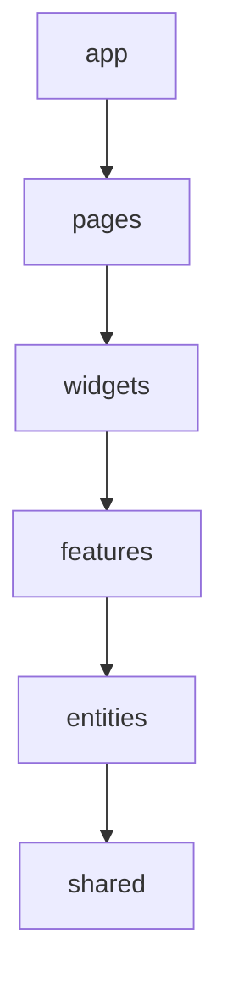

# AI Course Lab Frontend

Веб-интерфейс платформы генерации и прохождения курсов: каталог, создание курса с ИИ, редактор модулей и уроков, Drag & Drop-конструктор, обучение и метрики прохождения, организации и приглашения.

## Основной стэк

 - `React 18` / `TypeScript`
 - `Vite 5`
 - `Tailwind CSS 4` — новые стили (с префиксом `tw:`, см. ниже)
 - `CSS` — существующие стили: глобальные в `src/app/styles`, остальные рядом с компонентами
 - `Zustand` — состояние (сессия, права, тема, черновики редактора, метрики)
 - `React Router 7`
 - `react-markdown` / `remark-gfm` / `mermaid` — контент уроков
 - `@xyflow/react` — Drag & Drop-конструктор курса

## Команды

```bash
npm install
npm run dev        # http://localhost:5173, /api проксируется на http://127.0.0.1:8000
npm run build
npm run typecheck  # проверка типов TypeScript
```

## Архитектура

Разделяем приложение не по UI-компонентам, а по владению состоянием.

FSD-структура:

```plain
src/
├── app/
├── pages/
├── widgets/
├── features/
├── entities/
└── shared/
```

Правило зависимостей:



Слой может импортировать только из слоёв ниже себя. Импорт «вверх» или между соседними slices одного слоя запрещён.

где:
 - `app` — точка входа, роутер, провайдеры, глобальные стили, применение темы (никакой бизнес-логики);
 - `pages` — страницы (собирают интерфейс из виджетов и фич): каталог, курс, модуль, урок, практика, конструктор, профиль, организации, модели, вход;
 - `widgets` — крупные самостоятельные блоки: шапка, футер, хлебные крошки, урок с ИИ-чатом, сводка метрик;
 - `features` — действия пользователя с бизнес-ценностью: принятие приглашения, приглашение в организацию и в курс, создание курса и генерация модуля/урока через ИИ, редактирование контента урока, ИИ-наставник, тест и практика, прогресс;
 - `entities` — бизнес-сущности: курс, модуль, урок, контент-блок, пользователь/сессия, организация, приглашение, роль и права, прогресс, ИИ-модель;
 - `shared` — код без привязки к бизнесу: UI-кит (модалки, плавающее окно, тосты), вызов бэкенда, утилиты, хуки, конфиг, типы.

Текущая структура:

```plain
src/
├── app/
│   ├── router/                  # охрана маршрутов (ProtectedRoute)
│   ├── styles/                  # глобальные стили, index.css — точка входа
│   ├── App.tsx                  # маршруты и общее состояние страниц
│   ├── theme-bootstrap.ts
│   └── main.tsx
│
├── pages/
│   ├── home/
│   ├── catalog/
│   ├── course-edit/             # курс в режиме автора: модули, участники, публикация
│   ├── course-view/             # просмотр курса учеником и метрики для автора
│   ├── module-edit/
│   ├── lesson-edit/
│   ├── practice/
│   ├── creator/
│   ├── dnd-course/              # Drag & Drop-конструктор курса и его предпросмотр
│   ├── profile/
│   ├── organizations/
│   ├── models/
│   ├── auth/
│   └── invitation-accept/
│
├── widgets/
│   ├── header/
│   ├── footer/
│   ├── breadcrumbs/
│   ├── lesson-chat-workspace/   # урок + выдвижной ИИ-чат
│   └── course-metrics/          # сводка по курсу и метрики урока
│
├── features/
│   ├── accept-invitation/
│   ├── invite/                  # приглашения в организацию и на курс
│   ├── agent-interview/         # ИИ-интервьюер модуля и урока
│   ├── lesson-mentor-chat/      # ИИ-наставник по уроку
│   ├── lesson-assessment/       # тест и практика урока
│   ├── edit-lesson-content/     # редактор контент-блоков урока
│   ├── create-course-chat/      # создание курса в чате с ИИ
│   ├── edit-course-draft/
│   ├── track-generation/
│   ├── track-theory-time/
│   ├── course-progress/
│   └── upload-document/
│
├── entities/
│   ├── session/                 # сессия, текущий пользователь, права
│   ├── course/                  # курс, модули, уроки, контент-блоки
│   ├── progress/
│   ├── agent-chat/
│   ├── generation-job/
│   ├── organization/
│   ├── invitation/
│   ├── user/
│   └── ai-model/
│
└── shared/
    ├── api/
    ├── lib/
    └── ui/
```

Внутри slice код раскладываем по сегментам: `ui/` (компоненты и их CSS), `model/` (сторы, типы, хуки), `lib/` (чистые функции), `api/` (запросы), `config/` (константы). Наружу slice отдаёт только то, что экспортирует его `index.ts`. Экспорты — только именованные.

Конструктор `pages/dnd-course` пока живёт целиком внутри страницы: его стор и холст больше нигде не используются. Если часть понадобится другой странице, её выносим в `widgets` или `features`.

Внутри slice используем только относительные импорты. Между слоями — через алиас `@/` (`@/shared/ui`, `@/entities/course`) и только через публичный `index.ts` slice.

Если одной сущности нужен код другой сущности того же слоя, она берёт его только через явный публичный API `@x`: `entities/<сущность>/@x/<для какой сущности>.ts` (например, `@/entities/course/@x/agent-chat`). Такие связи держим минимальными.

## Работа с бэкендом

Не нужно городить отдельный api-слой: в `shared/api` лежит общий вызов бэкенда (`requestJson` — токен, обновление сессии, ошибки), его вызывают сторы и фичи.

```plain
                    React
                      │
                widgets/features
                      │
                   stores
                      │
                 requestJson
                      │
                    REST
                      │
                   Backend
```

Не создавать api-прослойку только потому, что запрос идёт на бэкенд. Отдельную функцию или adapter делаем, только когда:
- endpoint сложный;
- нужен mapper (например, курс с бэкенда → модель редактора);
- несколько HTTP-вызовов;
- хочется скрыть детали транспорта;
- у операции есть важное предметное имя;
- это опрос статуса генерации или streaming.

## Стили

- **Интерфейс при рефакторинге не меняется**: цвета, отступы, расположение остаются прежними. После переноса сверяем скриншоты до и после.
- Существующие CSS-файлы переносятся вместе со своим кодом, классы не переименовываются. Глобальные стили — в `app/styles` (`index.css` подключает их в прежнем порядке), стили компонента — в его `ui/`.
- Tailwind используем для нового кода и при правках существующего. Старый CSS массово на утилиты не переписываем, чтобы не менять интерфейс.
- Tailwind подключён без preflight и с префиксом: утилиты пишутся как `tw:flex`, `tw:gap-4`, `tw:text-sm`. Так они не конфликтуют с текущими классами `.container`, `.hidden`, `.section`.
- Утилиты Tailwind лежат в `@layer`, поэтому обычный CSS без слоя их перебивает. Если утилита «не работает», проверь, не задано ли это свойство в старом CSS.
- Цвета и размеры берём из CSS-переменных темы (`var(--text)`, `var(--accent)` и т. д.), а не хардкодим. Тёмная тема — `:root[data-theme="dark"]`.

## TypeScript

- Новый код пишем только на TypeScript (`.ts` / `.tsx`).
- Весь `src` переведён на TypeScript, `allowJs` выключен. Новые `.js` / `.jsx` не добавляем.
- `strict` включён. `any` без комментария не используем; данные с бэкенда описываем типами в `entities/*/model`. Для слабо типизированных ответов, которые ещё не описаны, есть `RawApiRecord` из `@/shared/api`.
- Перед коммитом: `npm run typecheck` и `npm run build`.

## Локальная разработка

- `?ai-mock=1` — демо-режим ИИ без расхода модели. Локальный мок лежит в `src/services/agentMock.local.js` (в репозиторий не коммитится), подключает его `shared/lib/agent-mock` только в dev-сборке.
- Локальные правки бэкенда, docker-override и скрипты тоже не коммитятся.

## Статус переноса

- [x] TypeScript, Tailwind (без preflight, префикс `tw:`), алиас `@/`, точка входа `src/app/main.tsx`
- [x] `shared/lib`: storage, errors, dom, media
- [x] `shared/ui`: toast, app-modal, confirm-dialog, floating-window, section-top
- [x] `shared/api`: `requestJson`, `jsonRequest`, `apiFetch`, сессия и токены, `ApiError`
- [x] `shared/lib/ui-layout`: история маршрутов, «Назад», восстановление скролла, UI-настройки страниц
- [x] `shared/ui`: mermaid-diagram, syntax-highlighted-code
- [x] `entities/session`: сессия, вход, текущий пользователь, права (`useAppPermissions`, `PermissionGate`); охрана маршрутов — `app/router/ProtectedRoute`
- [x] `entities/course`: запросы курса, модулей и уроков, мапперы бэкенд ↔ интерфейс, контент-блоки, уровни сложности
- [x] `entities`: organization, invitation, ai-model, user, progress; в course — кеш курсов, запись на курс, состояние дерева курса, выбор по адресу, проверочные вопросы, печать конспекта
- [x] `shared/api/attachments` (загрузка файлов), `shared/lib/theme`
- [x] `entities/agent-chat` (диалоги с ИИ-агентами и их API), `entities/generation-job` (запущенные генерации)
- [x] `features`: track-generation, edit-course-draft, upload-document, lesson-assessment; `utils/api.js` разобран полностью
- [x] `features`: track-theory-time (время и прокрутка теории), course-progress (прогресс курса и «моих курсов»); `shared/lib/activity`
- [x] UI сущностей: course (карточки курса/модуля/урока, списки, дерево навигации, блоки теории), agent-chat (markdown ответа); `shared/ui/content-preview`; виджеты header, footer, breadcrumbs
- [x] UI фич: invite (приглашения в организацию и на курс), edit-course-draft (панель сохранения черновика); `shared/ui/text-diff`
- [x] UI фич: agent-interview (ИИ-интервьюер модуля и урока), lesson-mentor-chat (ИИ-наставник), lesson-assessment (тест и практика урока); виджет lesson-chat-workspace
- [x] Виджет course-metrics: сводка по курсу, метрики теории урока, стор метрик и форматирование
- [x] Страница `pages/course-view` (просмотр курса и метрики); нумерация модулей и уроков в списках по порядку, с 01
- [x] UI фич: edit-lesson-content (редактор урока), create-course-chat (создание курса в чате с ИИ), accept-invitation
- [x] Остальные страницы: home, catalog, creator, auth, invitation-accept, models, organizations, profile, course-edit, module-edit, lesson-edit, practice, dnd-course (конструктор и предпросмотр)
- [x] `App.jsx` → `app/App.tsx`, глобальные стили → `app/styles`, `allowJs` выключен
